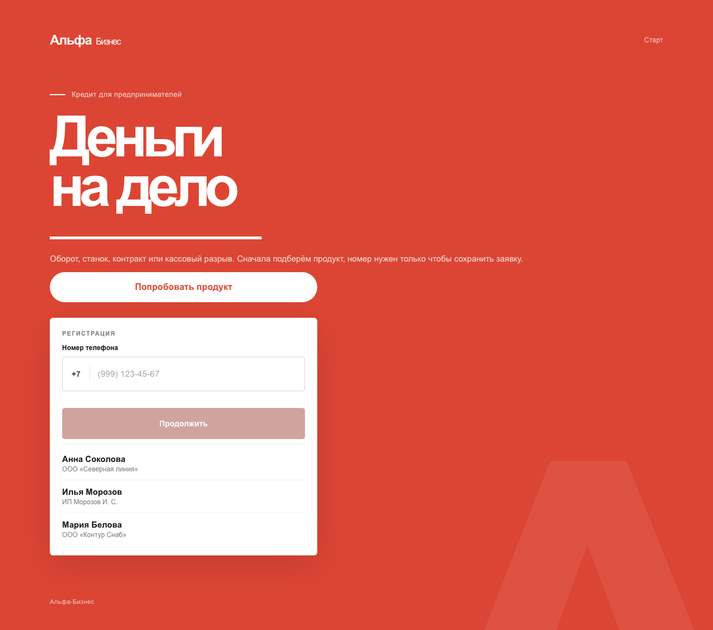
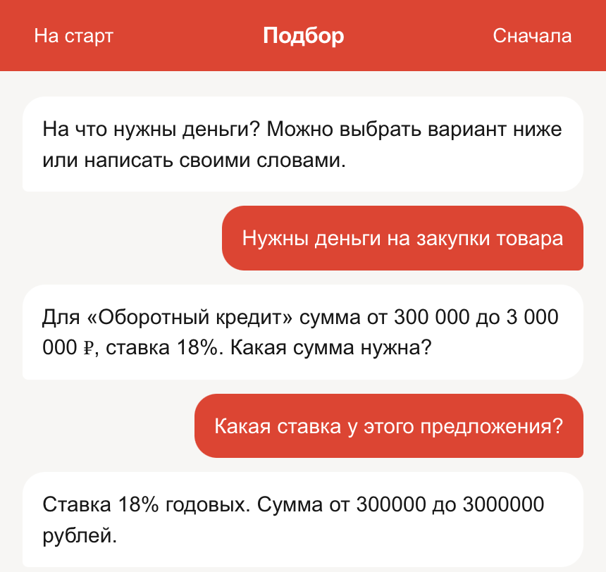
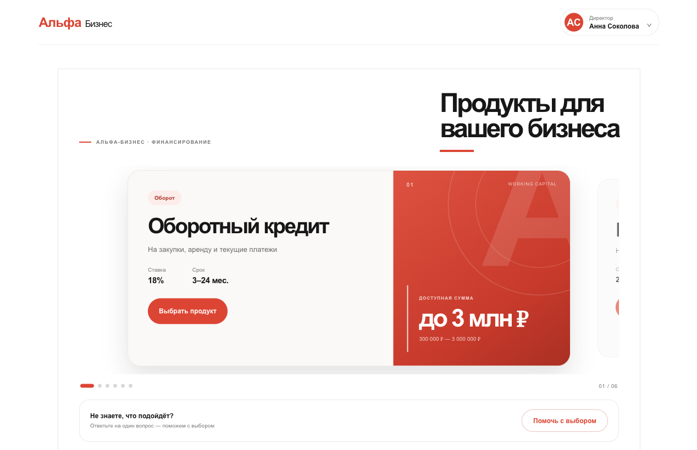
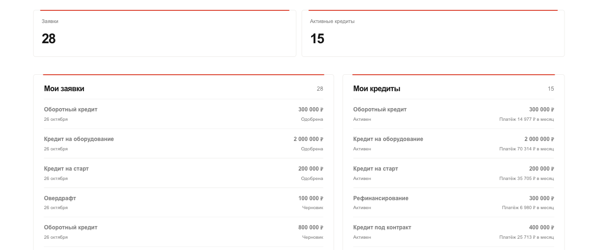

# Альфа-Бизнес — кредитный кабинет

Кабинет для небольшого бизнеса: человек описывает задачу своими словами, чат подбирает кредит и доводит заявку до конца ещё до регистрации. Сумму, срок и решение считает формула. Qwen 2.5 на 1,5 млрд параметров только произносит уже найденные факты и не дообучена под этот чат.

Нужны Docker и Docker Compose. Отдельный `.env` не обязателен. Из корня репозитория:

```sh
docker compose up --build
```

Сайт открывается на http://localhost:8080. API слушает http://localhost:8000, готовность процесса — http://localhost:8000/health. Другие порты задаются `FRONTEND_PORT` и `BACKEND_PORT`.

Первый запуск качает Qwen, около 1,1 ГБ. Пока файл не скачан и модель не села в память, в консоли идёт строка «Qwen ещё качается, контейнер не готов» и сколько мегабайт уже есть. Сайт поднимается после строки «Qwen готова, контейнер поднят»: бэкенд ждёт готовый сервис `qwen`.

Без модели, на тех же заявках и той же базе:

```sh
docker compose stop qwen
docker compose -f docker-compose.yml -f docker-compose.no-model.yml up -d --build
```

`qwen` не стартует, чат ведёт формула. Как проверить, что заявка всё равно доходит до кабинета: `docs/advisor-no-model.md`.

Модель работает на CPU. Видеокарта не нужна. Вместе с базой и сайтом процессу стоит оставить около 4 ГБ памяти. `docker compose stop` гасит стенд и оставляет заявки и скачанные веса.

## Сначала пробуют продукт



Сверху кнопка «Попробовать продукт», ниже регистрация номером. Номер ищет готовый профиль и не создаёт нового пользователя. Списка продуктов на этой странице нет.

## Чат

В чате можно спросить про условия или сразу описать дело. Поиск идёт по карточкам продуктов. Если вопрос про «этот кредит» или «что ещё», берутся последние реплики. Если человек просит оформить заявку, чат называет следующий шаг анкеты. Когда карточки нет, модель отказывает и не выдумывает ответ. Пока `qwen` не поднялся, те же шаги говорят заготовленные фразы.



«Нужны деньги на закупки товара» — оборотный кредит, 18%, от 300 000 до 3 000 000 ₽. Вопрос «какая ставка у этого предложения?» не открывает второй продукт: в ответе те же 18% и та же вилка.

Дальше формула спрашивает сумму, срок и выручку. Для старта в тексте плана нужно число выручки, например `180000`. Потом номер из таблицы ниже и код `0000`. СМС не отправляется, код написан в чате. Заявка сохраняется на этот номер.

## Кабинет





После кода из чата заявка лежит на этом номере. В кабинете видны продукты, решение по заявке и платёж по уже открытому кредиту.

| Номер | Кто |
| --- | --- |
| 79001000001 | Анна Соколова, ООО «Северная линия» |
| 79001000002 | Илья Морозов, ИП Морозов И. С. |
| 79001000003 | Мария Белова, ООО «Контур Снаб» |

## Зачем в чате маленькая модель

Человек пишет своими словами: «нужен станок», «а какая ставка», «давай оформлять». Шесть кнопок закрывают цель. Свободный вопрос и чужая тема в кнопки не помещаются. Модель нужна, чтобы ответить фразой в том же чате.

Ставка, сумма и срок лежат в карточках `ML/knowledge`. Поиск по карточкам подставляет в ответ фрагмент одного продукта. Вопрос «этот кредит», «что ещё» или «а срок?» смотрит последние реплики и берёт карточку уже выбранного продукта. Если карточки нет, чат отказывает по этой теме и не сочиняет условия. Лимит и платёж считает формула, от формулировки ответа они не зависят.

Голос — Qwen2.5-1.5B-Instruct: 1,5 млрд параметров, квант Q4, около 1,1 ГБ, только CPU, без адаптера. Версия Instruct держит короткую инструкцию: пересказать абзац и не подменить вопрос. Шесть карточек и одна реплика — вся работа голоса, поэтому этой величины хватает. Факты уже в карточке, арифметика уже в формуле. Модель живёт в том же Compose, отвечает в том же запросе и стартует на обычном процессоре. Пока веса не готовы, те же шаги говорит заготовка, и анкету можно пройти без модели.

## Продукты

У каждого свои ставка, сумма и срок. Дольше 60 месяцев взять нельзя.

| Продукт | Ставка | Сумма | Срок |
| --- | --- | --- | --- |
| Оборотный | 18% | 300 000–3 000 000 ₽ | 3–24 мес. |
| Старт | 24% | 200 000–1 000 000 ₽ | 6–36 мес. |
| Оборудование | 16% | 500 000–5 000 000 ₽ | 12–60 мес. |
| Контракт | 19% | 400 000–2 000 000 ₽ | 3–18 мес. |
| Овердрафт | 22% | 100 000–1 500 000 ₽ | 1–12 мес. |
| Рефинансирование | 14% | 300 000–4 000 000 ₽ | 6–60 мес. |

В кабинете уже лежат заявки и кредиты этих профилей. Новую заявку можно отправить по любому продукту из таблицы.
