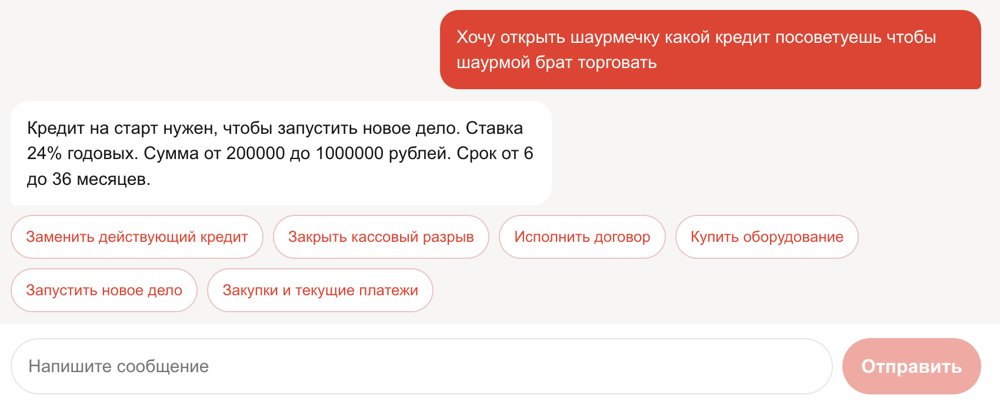
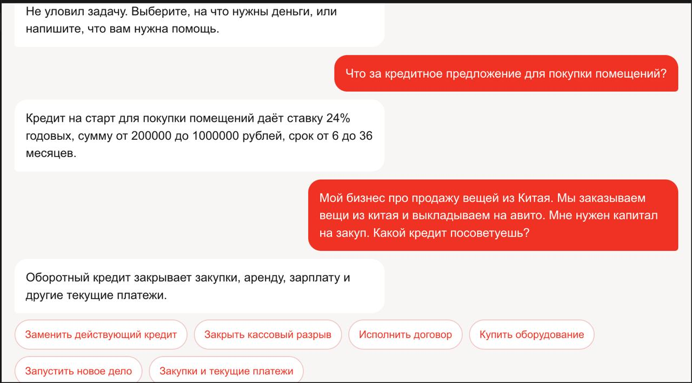

# Альфа-Бизнес — кредитный кабинет

Кабинет для небольшого бизнеса: человек описывает задачу своими словами, чат подбирает кредит и доводит заявку до конца ещё до регистрации. Сумму, срок и решение считает формула. Qwen 2.5 на 1,5 млрд параметров только произносит уже найденные факты и не дообучена под этот чат.

Нужны Docker и Docker Compose. Отдельный `.env` не обязателен. Первому запуску нужно скачать модель, около 1,1 ГБ, и дождаться, пока сервис `qwen` станет healthy. На это уходит несколько минут. Потом откройте http://localhost:8080

```sh
docker compose up --build
```

Модель работает на CPU. Видеокарта не нужна. Вместе с базой и сайтом процессу стоит оставить около 4 ГБ памяти.



## Чат

Сверху онбординг, кнопка «Попробовать продукт». Регистрация номером — внизу, и она не создаёт нового пользователя. В чате можно спросить про условия или сразу описать дело. Поиск идёт по карточкам продуктов. Если вопрос про «этот кредит» или «что ещё», берутся последние реплики. Если человек просит оформить заявку, чат называет следующий шаг анкеты. Когда карточки нет, модель отказывает и не выдумывает ответ. Пока `qwen` не поднялся, те же шаги говорят заготовленные фразы.



Дальше формула спрашивает сумму, срок и выручку. Для старта в тексте плана нужно число выручки, например `180000`. Потом номер из таблицы ниже и код `0000`. СМС не отправляется, код написан в чате. Заявка сохраняется на этот номер.

| Номер | Кто |
| --- | --- |
| 79001000001 | Анна Соколова, ООО «Северная линия» |
| 79001000002 | Илья Морозов, ИП Морозов И. С. |
| 79001000003 | Мария Белова, ООО «Контур Снаб» |

## Продукты

У каждого свои ставка, сумма и срок. Дольше 60 месяцев взять нельзя.

| Продукт | Ставка | Сумма | Срок |
| --- | --- | --- | --- |
| Оборотный | 18% | 300 000–3 000 000 ₽ | 3–24 мес. |
| Старт | 24% | 200 000–1 000 000 ₽ | 6–36 мес. |
| Оборудование | 16% | 500 000–5 000 000 ₽ | 12–60 мес. |
| Контракт | 19% | 400 000–2 000 000 ₽ | 3–18 мес. |
| Овердрафт | 22% | 100 000–1 500 000 ₽ | 1–12 мес. |
| Рефинансирование | 14% | 300 000–4 000 000 ₽ | 6–60 мес. |

В кабинете уже лежат заявки и кредиты этих профилей. Новую заявку можно отправить по любому продукту из таблицы.
